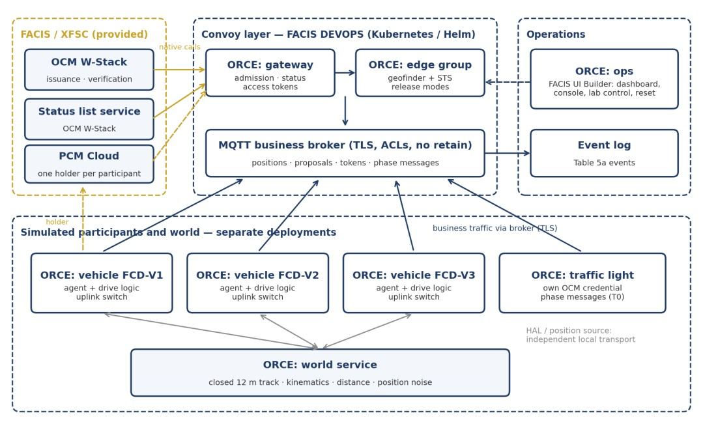

[← Data and interface definitions](07_data_and_interface_definitions.md) | [↑ Table of Contents](../README.md) | [Repository and delivery →](09_repository_and_delivery.md)

---

## 8 Architecture and implementation approach

### 8.1 Component overview

*Figure 1 Component Overview*

All CD components run as separate ORCE instances, each a separate Kubernetes deployment and failure domain: the federation gateway; the edge group with geofinder and STS; the dedicated MQTT business broker; the operations instance with dashboard, console and lab control built with the FACIS UI Builder package; one instance per vehicle containing agent and drive logic; the traffic light; and the world service. The gateway is the only component that calls the OCM W-Stack; vehicles reach the federation only through the gateway (FR-VEH-001). Logic that needs unit tests (token validation, deadline, discovery, STS session logic, profile checks) is implemented as plain JavaScript/TypeScript modules with injected clock and transport, wrapped by thin ORCE custom nodes, and tested in CI without ORCE, the cluster or the OCM W-Stack (NFR-CFG-004). Flows only connect these nodes.

### 8.2 Design decisions

<table>
<thead>
<tr><th align="left" style="background-color:#6b6b6b;color:#ffffff">Decision</th><th align="left" style="background-color:#6b6b6b;color:#ffffff">Statement</th><th align="left" style="background-color:#6b6b6b;color:#ffffff">Consequence</th></tr>
</thead>
<tbody>
<tr><td>Mandatory XFSC/FACIS stack</td><td>NFR-DEL-002, FR-GW-013: ORCE, OCM W-Stack, PCM Cloud, FACIS UI Builder</td><td>One technology stack; native verification and status; UI conformant with FAP via the UI Builder.</td></tr>
<tr><td>One STS, no dispatcher</td><td>FR-STS-001, FR-STS-002</td><td>Fixed scope; STS stop demonstrated by expiry stopping.</td></tr>
<tr><td>Token-borne release, expiry as the independent fallback</td><td>FR-STS-009 … 014, FR-VEH-006 … 010</td><td>No message is needed to stop; M4 shows it with blocked downlink.</td></tr>
<tr><td>Two release modes, one switch</td><td>FR-STS-006, FR-TL-002, FR-TL-003</td><td>release_mode in the profile; coordinated mode with fixed offsets per rank.</td></tr>
<tr><td>Separate failure domains</td><td>FR-SIM-002, FR-SIM-003, NFR-DEP002</td><td>Convoy layer can be stopped while vehicles and world keep running (T-12).</td></tr>
<tr><td>Demonstration instead of qualification</td><td>NFR-DEL-005, NFR-TIM-001</td><td>Acceptance by witnessed demonstration; Table 5a is explanatory.</td></tr>
<tr><td>Testable core modules</td><td>NFR-CFG-004, FR-GW-013</td><td>Logic in plain modules behind thin ORCE custom nodes; one adapter per OCM W-Stack function; expected test results taken from Tables 2a, 5b, 5c and 5g.</td></tr>
</tbody>
</table>

### 8.3 Dependencies and licences

The technology stack is fixed by NFR-DEL-002 (ORCE, OCM W-Stack, PCM Cloud, FACIS UI Builder package) and NFR-DEP-002 (Helm on the FACIS DEVOPS Kubernetes environment). All code is licensed under Apache-2.0; only Apache-2.0-compatible FOSS dependencies are used (NFR-DEL003). The MQTT broker product is named in the Integration Note (NFR-DEL-002).

---

[← Data and interface definitions](07_data_and_interface_definitions.md) | [↑ Table of Contents](../README.md) | [Repository and delivery →](09_repository_and_delivery.md)

